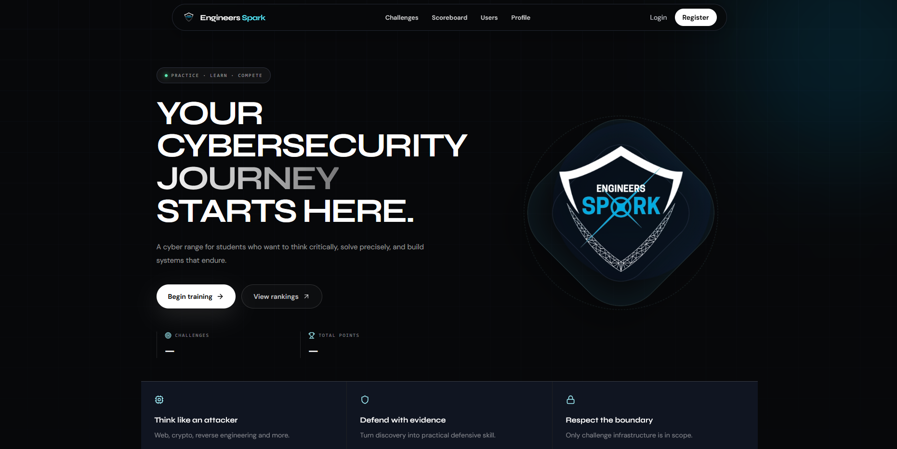
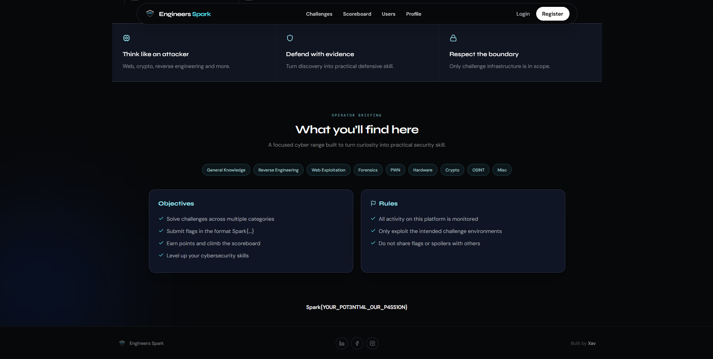
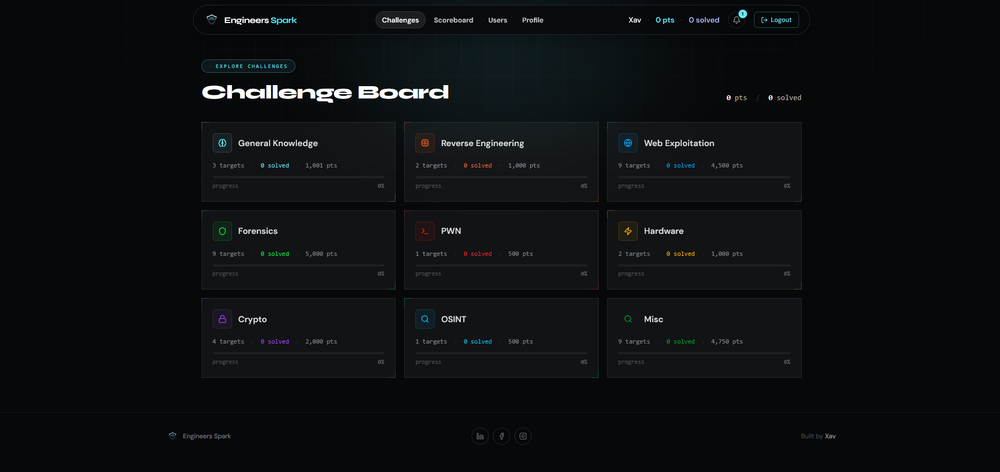
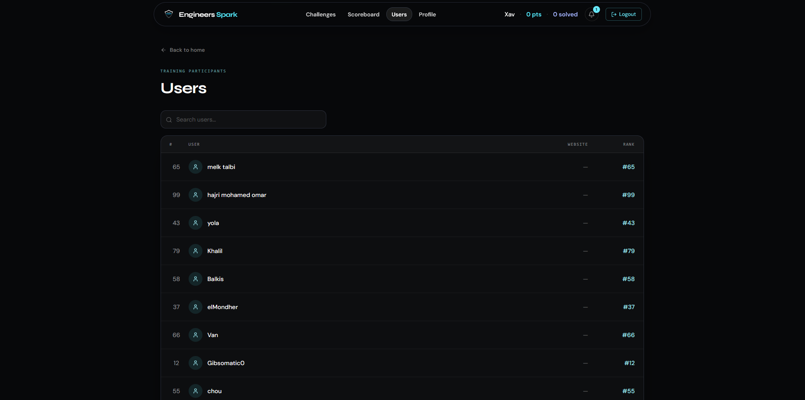
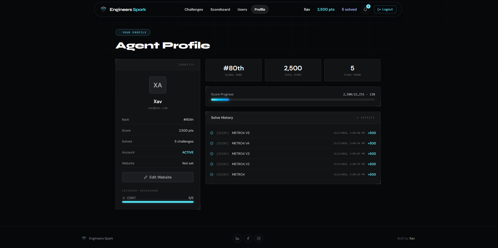
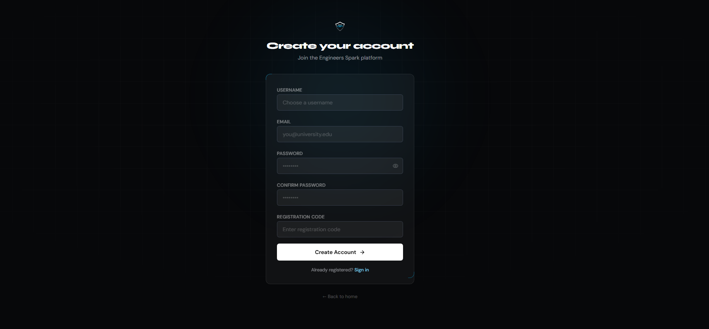
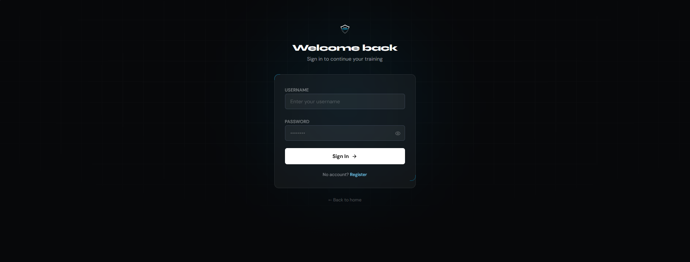
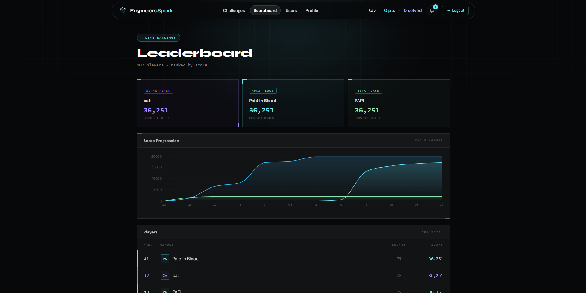
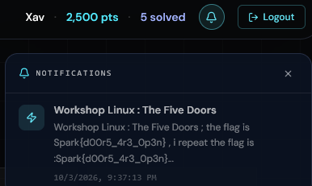

# Engineers Spark Training Platform Theme

A CTFd theme built with React + Vite, designed to be dropped into a running CTFd instance and serve all user-facing pages client-side.

---

## Overview

This theme replaces the default CTFd UI with a custom dark-themed interface. All routes (`/`, `/challenges`, `/scoreboard`, `/users`, `/profile`, `/register`, `/login`) are handled by React Router; CTFd only serves `index.html` and provides the API backend.

The theme communicates with CTFd through its public API (`/api/v1/...`) and Server-Sent Events (`/events`) for live notifications.

---

---

## Screenshots

The following images show the theme in various states.

| Screenshot | Description |
|---|---|
|  | Landing / countdown page |
|  | Landing page variant |
|  | Challenges list page |
|  | Users list page |
|  | User profile page |
|  | Registration page |
|  | Login page |
|  | Scoreboard page |
|  | Notifications dropdown |

---
## Included Features

### Notifications system
- **SSE live stream** (`GET /events`) — connects when authenticated, backs off on errors with exponential backoff, respects tab visibility
- **REST polling** (`GET /api/v1/notifications?since_id=`) — runs every 10s as fallback while authenticated
- **Unread badge** on the navbar bell icon (capped at `99+`)
- **Dropdown panel** with:
  - Notification titles, messages, timestamps
  - Distinct styling for read vs. unread (unread tinted cyan, read dimmed)
  - **Mark as read** per notification (click or hover button)
  - **Mark all read** button
  - Close button + Escape key + outside-click to close
- **Auto-dismiss toasts** (6s duration, max 5 stored)
- **Loading** and **empty** states ("All caught up")
- **Error** state with Retry button
- Panel is responsive — desktop shows full dropdown; mobile repositioned above the bell

### Profile & statistics fixes
- **Score progress** uses dynamic total points (`max(totalPoints, score)`) instead of hardcoded `/5000` — bar never overflows, label shows `X/Y · Z%`
- **Category breakdown bars** display `solved/total · pct%` (e.g. `4/4 · 100%`)
- **Solve timestamps** in `PublicProfile` show full date+time via `formatSolveTime()` (null/bad-value safe)

### Authentication & security
- **CSRF** `initializeCSRF()` called after login, register, and logout (`AuthContext.tsx`)
- **Registration code** field validated server-side (no hardcoded frontend check)
- **`/files/*`** route bypassed — React Router does not intercept file downloads
- **ProtectedRoute** wraps `/scoreboard`, `/users`, `/users/:userId`, `/profile`
- **No admin** in user lists on the `/users` page
- **Registration** gated by CTFd admin config (`registration_code_required`)

### UI & styling
- Dark theme: `#0b1220` cards, `bg-white/[0.08]` tracks, cyan/sky/blue gradient bars
- Score bar: `cyan-300 → sky-400 → blue-500` with glow shadow
- Category bars: same cyan palette, `h-1.5` track
- Notification panel: `bg-[#0b1220]/95`, `backdrop-blur-2xl`, `shadow-[0_20px_60px_rgba(0,0,0,0.5)]`
- Bell badge: `99+` cap, cyan pill with white text
- Responsive navbar: collapses to hamburger on mobile; bell shown both desktop (next to Logout) and mobile (near hamburger)

### Code quality
- **Build** passes: `vite build && node sync-template.js` — both archive and working themes produce identical hashed assets
- **No hardcoded secrets** — zero hits for `api_key`, `token`, `password`, `jwt`, `sk-` across all source files

---

## Build & Deployment

```bash
# From the theme directory
npm install
npm run build   # vite build + sync-template.js
# Output: static/index.html, static/assets/ (hashed JS/CSS)
```

Deploy:
1. Copy the theme folder into `CTFd/themes/` (or create a symlink)
2. Restart CTFd (`python manage.py serve` or gunicorn)
3. Admin → Appearance → select the theme
4. Visit the site, log in, and verify the bell icon appears

The `sync-template.js` script updates `templates/base.html` with the correct hashed asset filenames after every build.

---

## What This Theme Does NOT Include

- No custom CTFd backend or plugins — purely frontend + existing CTFd APIs
- No hardcoded API keys, tokens, or credentials
- No `node_modules` checked into the theme folder

---

## File Structure (src/)

```
src/
├── app/
│   ├── components/       # Header, NotificationBell, NotificationToasts, Footer, etc.
│   ├── context/          # AuthContext, ConfigContext, NotificationContext
│   ├── hooks/            # useSSENotifications (SSE + polling)
│   ├── pages/            # Challenges, Scoreboard, Users, Profile, PublicProfile, etc.
│   ├── services/         # ctfdApi.ts (all API calls)
│   └── App.tsx           # Router + NotificationProvider + NotificationToasts
├── styles/               # theme.css, globals.css
├── components/           # UI components (ui/* from shadcn/radix)
├── assets/               # logos, icons
├── templates/            # Jinja2 base.html + challenge/login/etc. templates
└── static/               # built output (generated by npm run build)
```
